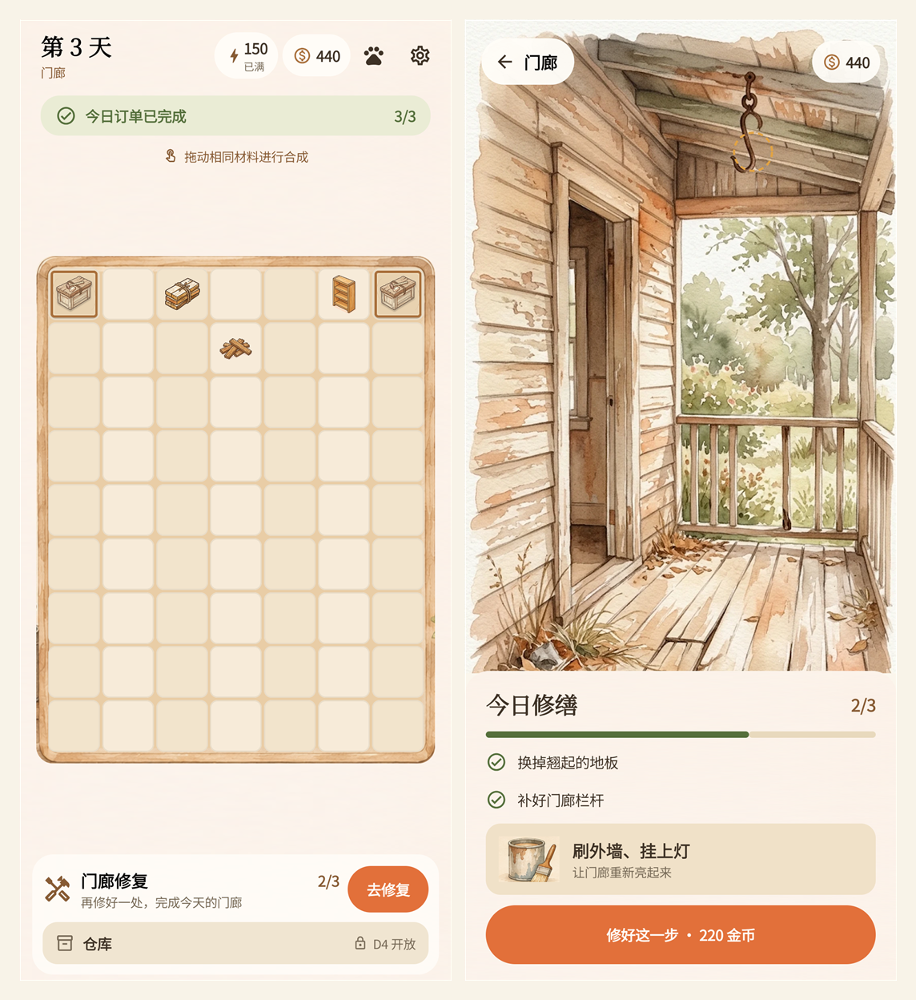

# 合成页与修缮页布局改版记录

> 历史方案已由 [2026-11-17 UI-v1](implementation-2026-11-17.md) 替代。以下日期、版本、校验值与测试结论保持原样，不代表新版验证。


日期：2026-11-16。本文记录首次界面验证时的本地开发快照；当时尚未提交、未发布。后续 Git 提交与版本归档请查看 [版本迭代记录](../版本迭代记录.md)。不覆盖根目录原有 APK，不更改版本号或冒充正式版本。

## 参考图已留档

- 用户确认的图：[layout-reference-2026-11-16.png](layout-reference-2026-11-16.png)
- 生成方式：ImageGen CLI，`gpt-image-2`，根据用户提供的两张页面截图生成。
- 原始提示词：[layout-reference-prompt.txt](layout-reference-prompt.txt)
- 后续界面修改应遵守根目录 [DESIGN.md](../../DESIGN.md)。
- 校验值与构建包信息：[layout-implementation-metadata.json](layout-implementation-metadata.json)。

## 本轮实现

### 合成页

- 紧凑日期/房间页头、体力和金币胶囊；窄屏或大字体时资源栏换到下一行，避免挤压辅助入口。
- 全部订单交付、且无工具待领取时，收起重复的大交付卡，改为苔绿色完成条；有活动订单或新工具时仍保留需求、领取与交付操作。
- 真实 7 × 9 棋盘置于浅木托盘；格子保持正方形，大小按可用宽高计算，最大 56dp，不沿用旧版的 44dp 上限。小屏空间不足时仍需缩小格子，这是保留 63 格并保证底部按钮可见的取舍。
- 保留既有物品美术、需求高亮、发射器节奏提示、低体力状态、点按产出与拖放手势。
- 底部显示实际房间修缮进度和橙色「去修复」按钮，仓库为次级入口。
- 保留出售/收进仓库、结束一天、图鉴、设置和长按调试，不改变 GameEngine 与存档格式。

### 修缮页

- 移除整条深灰遮罩，使用轻量悬浮返回与金币胶囊。
- 场景单独取景，底部纸质任务面板展示真实房间进度条、已完成/未来任务和当天任务。
- 陶土橙主操作只展示一次当天费用；金币不足时显示缺额并返回合成，已修好时返回棋盘。
- 小屏大字体下任务正文可滚动，底部主操作保持可见。
- 门廊最后一步在已有插画的空挂钩位置显示静态虚线任务标记；完成后移除，不添加持续闪烁。
- 把 BuildScreen 从 SecondaryScreens.kt 拆到独立文件，其他次级页面行为保留。

### 素材复现

`tools/prepare_layout_assets.ps1` 从已归档参考图提取真实纸纹、透明木框和画笔装饰。按钮、文字、棋盘格、资源值与进度均为原生 Compose，不是用整张预览图覆盖界面。

## 与概念图的差异 / 未完成的美术范围

1. 概念图两页的比例较宽；手机实际比例更长，因此留白和棋盘位置会随宽高变化，不做拉伸格子或裁掉行数的伪还原。
2. 预览图显示「2/2」，现有第 3 天内容实际上有 3 条订单，实际截图显示「3/3」。游戏读取真实数据，不为了对图而改订单数。
3. 金币、天数、任务名称、进度与费用都来自当前存档，截图中的第 3 天 / 440 金币仅为测试状态，不会覆盖玩家存档。
4. 当前每间房只有 before/after 两张插画，尚无每个修缮步骤的独立中间态。整间房完成后继续使用已有的前后变化；地板、栏杆、外墙与挂灯逐步改变需要补充相应场景资源，未把这部分声称为已实现。
5. 小型花草、工作台两侧摆件等非功能装饰未逐像素复刻，优先保证原生交互、阅读与不同屏幕适配。

## 验证与证据

最终实际执行结果和截图记录如下。截图为测试状态的 Compose 组件实拍，不包含真实手机系统状态栏；不是 AI 效果图。

### 复现命令

Windows 本机 Java 的 Unix-domain 临时通信目录出现兼容问题，因此仅为执行命令设置较短的 `jdk.net.unixdomain.tmpdir`；不修改系统环境或项目 Gradle 配置。

```powershell
$env:JAVA_TOOL_OPTIONS='-Djdk.net.unixdomain.tmpdir=D:\homework\androidwork\CatHouseMerge\build'
.\gradlew.bat :app:assembleDebug :app:assembleDebugAndroidTest --offline --no-daemon
.\gradlew.bat :core:test --rerun-tasks --offline --no-daemon
```

设备测试还执行过 `:app:connectedDebugAndroidTest`。为了在测试结束后保留原始截图，最终验证使用 adb 安装调试包与测试包后，直接执行：

```powershell
adb -s emulator-5554 shell am instrument -w com.example.cathousemerge.test/androidx.test.runner.AndroidJUnitRunner
```

截图从测试模拟器的应用 external files 目录取回，存入下方证据目录。


### 最终执行结果

| 验证 | 实际结果 |
|---|---|
| 调试 APK / 测试 APK 编译 | 通过 |
| 纯 Kotlin 单元测试（强制重新执行） | 44 项，0 失败，0 错误 |
| Android 16 模拟器设备测试（最终构建） | 18 项全部通过 |
| 设备端组成 | 2 项 GameFlow、7 项既有 IterationUi、7 项新增 RestorationLayout、2 项存档测试 |
| 新增场景 | 订单完成折叠、63 格与导航、活动订单/待领取工具、小屏大字体合成页、真实进度/单次费用与建造派发、金币不足返回、修缮页主操作固定、整间房完成；部分场景在同一测试中验证，不把断言数冒充测试数 |
| 改动范围的 diff 空白检查 | 本轮修改的界面 Kotlin 文件通过；仓库其他既有未提交改动没有自动格式化或修复 |

原始设备测试输出：[device-test-result-2026-11-16.txt](device-test-result-2026-11-16.txt)。

### 最终实际截图

以下是运行在测试模拟器中的真实 Compose 组件截图，不是设计参考图。拼图仅等比缩小并并排排版，没有生成式修改。



- [合成页：订单全部完成](screenshots-2026-11-16/board-completed.png)
- [合成页：活动订单与待领取工具](screenshots-2026-11-16/board-active-orders.png)
- [合成页：320 × 640dp、1.3 倍字体](screenshots-2026-11-16/board-compact-large-font.png)
- [修缮页：可支付](screenshots-2026-11-16/repair-affordable.png)
- [修缮页：金币不足](screenshots-2026-11-16/repair-insufficient-coins.png)
- [修缮页：整间已完成](screenshots-2026-11-16/repair-completed.png)
- [修缮页：320 × 568dp、1.4 倍字体](screenshots-2026-11-16/repair-compact-large-font.png)

当前调试包位于 `app/build/outputs/apk/debug/app-debug.apk`，SHA-256 记录在本页旁的 `layout-implementation-metadata.json` 中；根目录原有 `app-debug.apk` 未覆盖。首次界面验证时未执行 Git 提交、推送、打标签或正式发布；后续提交状态以版本迭代记录为准。
