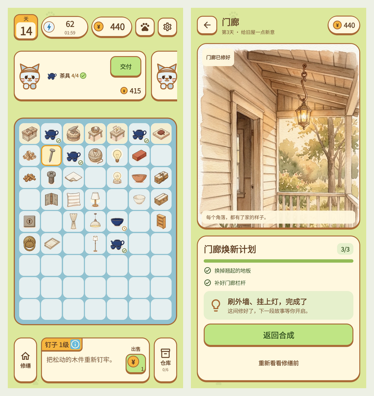

# UI-v1 原生迁移、文档合并与版本升级

日期：2026-11-17。设计文档 **v0.3**；应用 **0.3.0 / versionCode 3（待验收、未发布）**。

## 合并范围

用户确认 `UI-v1/` 原型并迁移 Compose 后，本轮将设计合并进原 DESIGN、06、07，更新 README、HANDOFF、美术清单、Figma 历史入口、更新日志与版本记录，不另起冲突规范。

视觉与交互见 [DESIGN](../../DESIGN.md)、[06](../06-UI-UX设计规范.md)。正式售价、D4仓库与容量、当天推进条件仍由引擎决定；没有修改 core、存档格式或内容数值，也没有迁移网页调试开关与模拟设置。

应用由0.2.0/2更新为0.3.0/3；欢迎页已动态读取版本，设备测试断言和截图前缀本轮改用 BuildConfig.VERSION_NAME。

## 升级前真实验证（0.2.0 / 2）

- 44项核心测试通过，使用 --rerun-tasks 实际重跑。
- 29项完整模拟器测试通过，另有大字号定向检查通过。
- Android16/API36，1080×2400、density420；组件场景含360×780、320×640、320×568及1.3/1.4倍字号。
- 报告 `artifacts/ui-v1-migration/verification.json`；最终日志 `device-tests-final.log`、`large-font-final.log`、`final-build.log`。
- 旧APK：0.2.0/2，SHA-256 `62F217349B05E1313133DEB4F424A25D1DC6D0A868638CEA4228E094EC431EC3`。
- 旧报告 documentation_merged=false 是合并前快照，原样保留，不代表本轮状态；其中哈希与测试只对当时源码和APK负责。
- `artifacts/ui-v1-migration/screenshots/` 是独立测试状态的原生组件实拍，不含系统栏，不是一条连续游玩存档。

## 版本升级后检查（0.3.0 / 3）

- 离线执行 `:app:assembleDebug :app:assembleDebugAndroidTest --offline --no-daemon`：**BUILD SUCCESSFUL**，新APK及设备测试包编译通过。
- 通过 aapt 读取新APK实际 Manifest：versionName=0.3.0、versionCode=3。
- 新APK：`app/build/outputs/apk/debug/app-debug.apk`，SHA-256 `B581F952852CBC9163373A7E0E56763D3FB67349DA5280C9BEFC00D4025CF4B5`。
- 文档本地Markdown链接与当前版本断言检查通过；`git -c core.whitespace=cr-at-eol diff --check`通过（原文档部分使用CRLF）；core与存档仓储没有差异。
- 本轮没有重新启动模拟器执行设备测试，也未重跑核心测试；上述44/29项仅属于升级前迁移验证，新版仅确认构建与静态一致性。
- 新检查报告与构建日志：`artifacts/ui-v03-doc-merge/verification.json`、`build.log`。旧报告保持原样。

## 历史与交付边界

[11月16日旧方案](implementation-2026-11-16.md)、0.1.0/0.2.0归档及原Word保留，不回写历史。旧Figma SVG不再覆盖当前两页。其他页面和动效清单未完成的目标仍待验收，不宣称本轮全部实现。未自动提交、推送、打标签或发布Release。
