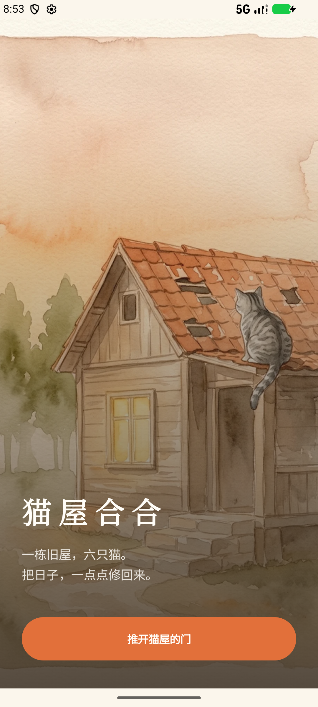
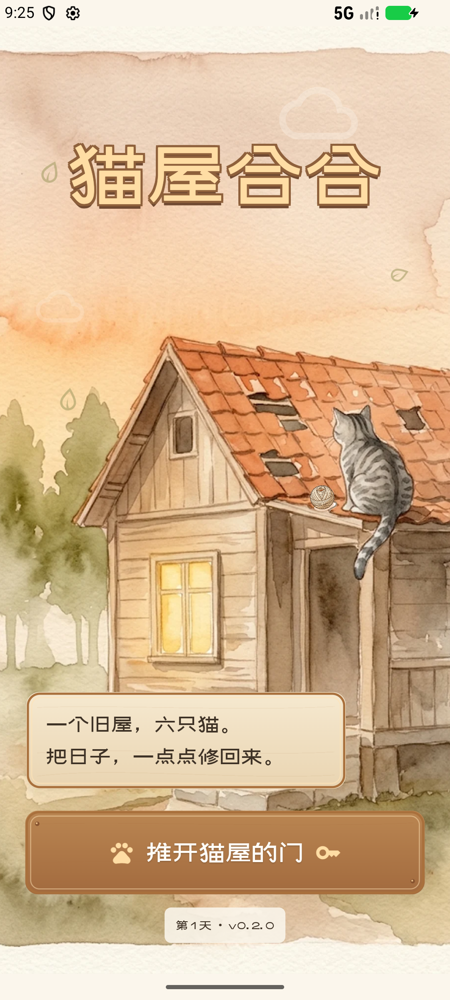
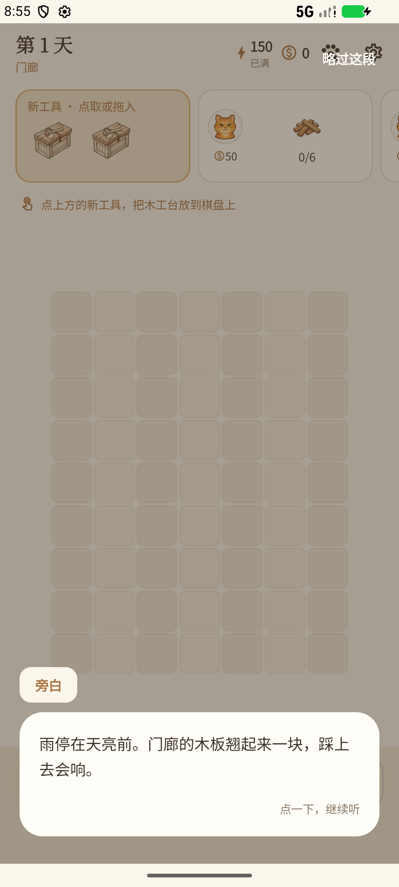
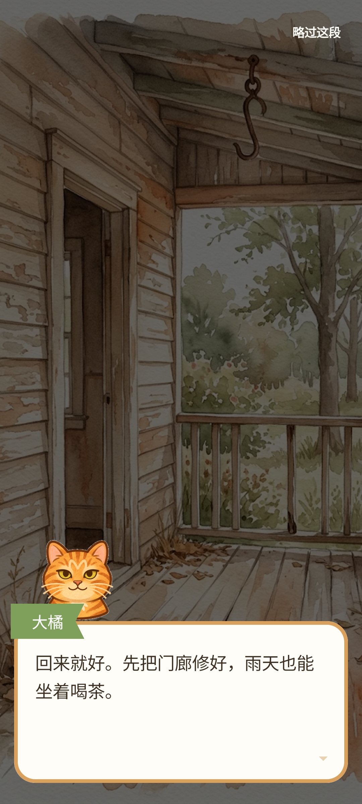
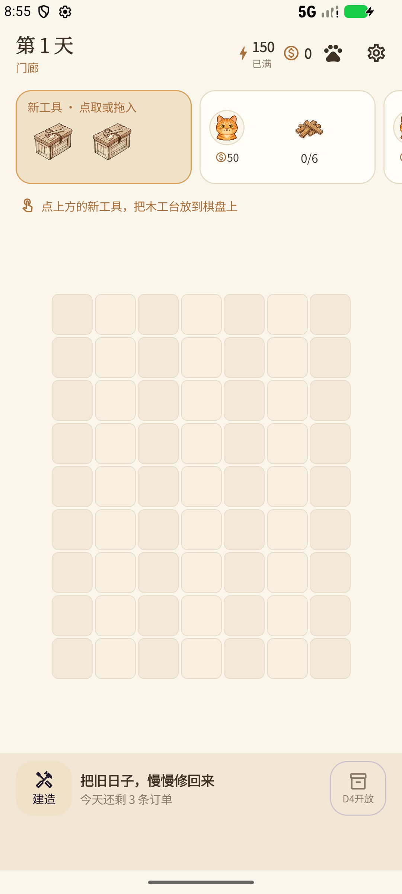
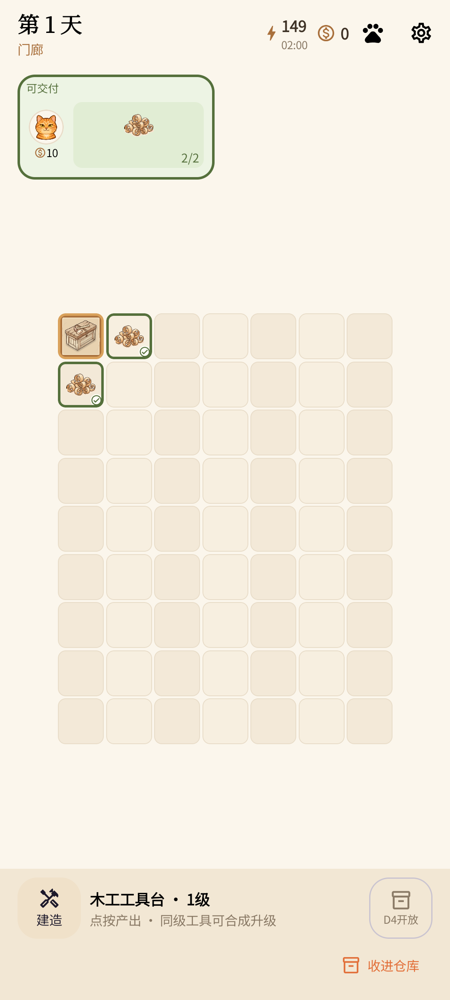

# 猫屋合合版本迭代记录

本文供课程验收与团队协作用，说明真实的开发历史、问题如何修正、每版如何验证，以及如何找回源码与 APK。源码提交历史、可安装包和测试证据应互相对应，不补造历史提交或发布记录。

## 当前状态

| 项目 | 记录 |
|---|---|
| 初版 APK | 0.1.0，versionCode 1，用户提供，原件未覆盖 |
| 修改前源码 | `90216940b9b0c255d389efe6d36a94ee61b832f7` |
| 本轮工作分支 | `codex/problems-v1` |
| 当前开发版本 | 0.2.0，versionCode 2，源码已本地提交、待验收／未发布 |
| 修改依据 | 根目录 problems-v1.docx 的本地版本，SHA-256 见基线 JSON |
| 版本基线 | [元数据与原始 APK 校验值](iterations/v0.1.0-baseline.json) |

初版 APK 已另存至 `artifacts/versions/v0.1.0/CatHouseMerge-v0.1.0-original.apk`。这个目录仅供本地留档，不上传 Git。原来的根目录 APK 继续保留。用户 APK 的构建提交未经核对，不声称它就是由 `9021694` 构建的。

## 本轮本地预览归档

归档目录：`artifacts/versions/v0.2.0-preview-20261114-221851/`。

- 新版 APK：`CatHouseMerge-v0.2.0-preview-20261114-221851.apk`
- `metadata.json`：版本号、源码基线号、未提交标记、APK 和源码快照的 SHA-256。
- `CHANGELOG.md`：本轮更新说明副本。
- `CatHouseMerge-v0.2.0-source-preview.zip`：本轮额外保存的可构建源码与资源，已校验 ZIP 完整性，便于在提交前恢复预览；不含 Git 历史、本机配置、缓存或完整 art 设计素材。

该目录仅保存在本地，被 Git 忽略。通用归档脚本默认保存 APK、元数据和更新说明；本轮另做了源码快照。**这不是正式 Release，也不是已经提交的 v0.2.0 Git 版本**，小组确认后仍应提交并打标签。

## 本轮问题与修改对应关系

| 编号 | 原问题或需求 | 本轮实现 | 验证证据 |
|---|---|---|---|
| P01 | 需求格满足与否不醒目 | 灰黄／绿色需求格、持有数角标、可交付整卡高亮 | 核心反馈测试、设备订单状态测试、前后截图 |
| P02 | 棋盘物品缺少订单状态 | 暖黄／绿色描边和不同图标，语义说明当前订单与数量 | 设备棋盘状态测试 |
| P03 | 同物品涉及多订单时状态冲突 | 选择剩余需求最少的未交付订单，并列从左到右 | 最近订单、并列、排除已交付、重复需求测试 |
| P04 | 发射器邻格满就无法产出 | 相邻空位优先，否则全盘最近空位；距离并列取上、再左 | 落点测试，遍历 63×62 个发射器／唯一空位组合 |
| P05 | 应用图标需更换 | 自适应图标与圆形图标均使用 cat_meiqiu_happy 作为前景 | 构建包元数据与模拟器核对 |
| P06 | 对话框提示与排版不符 | 当前房间压暗 60%、木框、绿丝带、头像、快进／下箭头；宽度与字号感知分页 | 对话按钮测试、窄屏大字不丢字测试、截图 |
| P07 | 发射器与材料外形易混 | 35 张内置木托 384px 图；棋盘仍最多 44dp；原始资源不改 | 资源脚本、设备截图 |
| P08 | 发射器缺少清晰而安静的点击提示 | 3s 闲置、4s 周期、徽标与 600ms 放大分时、单台优先、10s 冷却、低体力禁动效 | 核心提示策略测试、设备验证 |
| P09 | 封面层次不足 | 天空标题、木质文案牌／按钮、爪印钥匙、落叶云朵、线团；保留一猫一旧屋 | 封面按钮测试、前后截图 |
| P10 | 封面统一指定字体 | 随包加入本地狸叶黑体，只用于封面，文档不改字体 | 实际封面截图、字体原文件校验 |

## 本轮实测结果

验证日期：2026-11-14。本地验证通过不等于已由老师验收或已正式发布。

| 验证项目 | 实测结果 | 说明 |
|---|---|---|
| 纯 Kotlin 单元测试 | **44 项通过，0 失败、0 错误** | 含 8 项新增测试；其中一个测试遍历 3,906 组发射器／唯一空位组合，不把这些循环次数冒充独立测试数量 |
| Android 设备端测试 | **11 项通过，0 失败、0 跳过** | 2 项完整交互流程、2 项存档恢复、7 项新增界面测试；Android 16 测试模拟器 |
| 调试构建 | **通过** | `versionName=0.2.0`，`versionCode=2`，`minSdk=26`，`targetSdk=35`；APK 已核对版本与签名 |
| Android Lint | **0 错误，11 条警告** | 未隐藏或禁用检查；警告逐类记录如下 |
| 图片与字体 | **通过检查** | 35 个发射器均映射到内置木托变体；原始生成器图片不改动，也不重复打包；指定字体与本地源文件校验一致 |
| 初版与问题文档保护 | **校验一致** | 根目录初版 APK 与本轮依据的问题文档未被修改；基线 JSON 保留 SHA-256 |
| 人工视觉核对 | **已查看运行截图** | 常规封面、320×568dp／1.3 倍字号封面、对话、订单欠缺／满足、低体力单台提示；非手机真机验收 |

### Lint 警告说明

- 7 条为 SDK、Gradle 或运行时依赖有可更新版本的建议。本轮保留原来的 SDK 与游戏运行时依赖版本，仅升级 Android 16 测试兼容性所需的测试框架。
- 2 条与竖屏锁定及大屏方向兼容有关。游戏仍按原设计竖屏运行，未宣称已适配所有平板和桌面窗口。
- 1 条为新版 Android 的数据提取规则建议；本轮没有改动原有禁用备份策略。
- 1 条为图标资源 `v26` 目录限定可简化的提示；不影响当前 `minSdk=26` 的安装与显示。

完整机器可读验证摘要见 [本轮验证记录](iterations/v0.2.0-verification.json)。临时原始日志和详细 HTML 报告位于本地 `build/review/` 与 `app/build/reports/`，不会作为源码上传。

### 尚需小组确认

- 在实际手机上验收手感、长时间运行和性能；本轮不把模拟器测试当成真机测试。
- 确认初版作者的签名或备份方案，避免试装时丢失旧进度。
- 确认指定字体的嵌入／再分发授权，再决定是否公开发布。
- 检查改动后按功能提交、打标签、发布 Release；本轮没有自动进行这些远端操作。


## 修改前后截图

截图来自测试模拟器，不是设计稿。初版来源是用户 APK；新版界面专项测试会使用受控的订单、棋盘和对话数据，不能把它伪装成两次完全相同存档下的操作。封面另以实际 MainActivity 启动核对。

| 界面 | 修改前 初版 APK | 修改后 0.2.0 |
|---|---|---|
| 初始封面 |  |  |
| 对话框 |  |  |
| 棋盘与订单 |  |  |

### 更多状态与边界截图

- [封面前后并排对比](iterations/screenshots/cover-comparison.png)
- [需求尚未满足与 1/2 数量](iterations/screenshots/v0.2.0-board-demand-missing.png)
- [低体力时只有一台显示灰色斜杠徽标](iterations/screenshots/v0.2.0-generator-no-energy.png)
- [320×568dp、1.3 倍字号的封面布局](iterations/screenshots/v0.2.0-welcome-compact.png)

订单专项截图使用一张 `wood_1 × 2` 的受控测试订单，以清楚演示反馈；正式内容 JSON 仍保留原来的 112 条订单。新版组件截图不含测试活动的系统状态栏，实际启动封面另保留完整模拟器画面，避免把测试框架的状态栏覆盖误认为游戏布局缺陷。

## 安装与存档安全

本次用 `apksigner verify --print-certs` 核对，用户初版与这台电脑新构建的调试包证书不同：

- 初版签名证书 SHA-256：`34e107e195d14024d1177a1fe5c6df0cb0bed7091de6c5259eb8c21fb558b014`
- 本地新版签名证书 SHA-256：`c3b1b44860847b613a611f6e7b49466a92b273a76cc410e7054b506d6956d1ee`

它们包名相同，但不能作为普通同签名更新直接覆盖安装。**不要为了试新版就在有进度的手机上直接卸载旧版**，卸载可能清掉存档；应先确认存档备份或由初版作者使用原签名重新构建新版。游戏存档格式没有在本轮改变，但这不能绕过 Android 的安装签名检查。

本轮仅在新建的只读测试模拟器 `emulator-5556`／`emulator-5558` 中替换安装，未对用户手机操作。两人协作后续应使用受控的同一演示签名流程，密钥和密码不要提交到 Git 仓库。调试包不是应用商店正式发布包。

## 每次迭代的保存流程

### 第一步 按功能提交真实改动

完成一个可解释的小改动并测试后再提交，例如：

```powershell
# 先检查，不要误把同伴的文件一起提交
 git status --short
 git diff
# 用具体路径暂存这一组功能，不建议不检查就 git add .
 git add core/src/main/kotlin/com/example/cathousemerge/game/GameEngine.kt core/src/test/kotlin/com/example/cathousemerge/game/GameEngineTest.kt
 git commit -m "fix: 发射器邻格满时寻找棋盘最近空位"
```

建议按“生成规则与测试”“订单状态反馈”“对话与封面视觉”“验证记录与版本号”分组提交。`problems-v1.docx` 和 `.gitignore` 在本轮开始前已存在用户修改，提交前要明确是否一起纳入，不擅自代为提交。若希望同伴和老师复现本轮修改依据，确认内容后应把最新问题文档一并提交，或作为对应版本的附件保留。

### 第二步 验证并保存安装包

更新 `CHANGELOG.md`，保证目标源码已提交且工作区干净，再运行：

```powershell
powershell -ExecutionPolicy Bypass -File tools/archive-version.ps1
```

脚本读取应用实际版本号，执行单元测试和调试构建，保存 APK、SHA-256 和源码提交号。它拒绝覆盖已有版本目录，默认拒绝未提交工作区。`-AllowDirty` 只能保存标记为预览的本地快照，不能作为已发布源码一致性的证明。

初版已经单独留档，之后不再覆盖根目录 `app-debug.apk`。每版 APK 放到不同目录，也可附到对应的 GitHub Release，不把二进制安装包塞进普通 Git 提交。

### 第三步 为验收版本打标签并推送

验收通过后，由仓库维护者执行，版本号按实际情况修改：

```powershell
 git tag -a v0.2.0 -m "0.2.0 订单反馈与交互改进"
 git push origin codex/problems-v1
 git push origin v0.2.0
```

如果先把功能分支合并到 `main`，应切到 `main` 更新后，在合并提交上打标签，而不是随便选择一个旧提交。已有发布标签不要移动。

随后在 GitHub 的 Releases 页面创建对应版本，选择该标签，粘贴更新说明，上传 APK 和校验值。两位协作者都使用自己的账号提交，保留真实作者信息。

### 第四步 向老师展示

1. 打开本文件，按问题、修改和实测证据讲解。
2. 展示 GitHub 提交历史与前后差异，也可本地运行 `git log --graph --oneline --decorate --all`。
3. 展示两个版本标签或 Release，以及对应的 APK。
4. 对照修改前后截图，必要时用两个版本演示关键行为。

只有 APK 文件名不同不足以证明代码如何迭代；只有一次包含所有文件的大提交，也不如按真实功能形成的提交记录清楚。

## 已有源码提交历史

以下表格从本轮修改前的真实 Git 历史导出，时间统一为北京时间，作者按 Git 原记录展示。没有新增或伪造历史提交。

| 北京时间 | 提交 | Git 作者 | 真实提交说明 |
|---|---|---|---|
| 2026-11-11 13:33 | `c30d438` | damiao11 | init |
| 2026-11-11 13:37 | `d0dd7b6` | damiao11 | docs + assets + ui（不含 art 源文件） |
| 2026-11-11 13:44 | `3c87a94` | damiao11 | art/ 原始素材与提示词存档 |
| 2026-11-11 13:46 | `9401997` | damiao11 | README：补充仓库地址与交付说明入口 |
| 2026-11-11 15:18 | `eac8402` | 2024210402002 | 建立 Android Compose 工程及共享游戏模型 |
| 2026-11-11 15:26 | `32830ed` | 2024210402002 | 校验游戏内容并落实后期订单与角色数据 |
| 2026-11-11 15:26 | `f9a60d6` | 2024210402002 | 实现不可变游戏引擎与完整24天核心流程测试 |
| 2026-11-11 15:29 | `4411e19` | 2024210402002 | 实现猫屋合合完整 Compose 界面与拖拽交互 |
| 2026-11-11 15:30 | `8980e1a` | 2024210402002 | 保持棋盘选择前后布局稳定 |
| 2026-11-11 15:36 | `a42a03e` | 2024210402002 | 完善拖拽预览取消处理及可合成高亮 |
| 2026-11-11 15:46 | `a68ac9c` | 2024210402002 | 集成存档设置剧情选择并通过完整Android流程验证 |
| 2026-11-11 15:56 | `0fc74fd` | 2024210402002 | 修正中文字体默认字重以提高界面可读性 |
| 2026-11-11 18:28 | `579b95a` | 2024210402101 | fix: 修正订单无效链与物品价值字段 |
| 2026-11-11 20:19 | `4c18ffb` | 2024210402101 | docs: 对话界面按参考图重做，补问题记录 |
| 2026-11-14 13:27 | `e617ef6` | 2024210402002 | 添加主线程ANR与后台计算对照实验 |
| 2026-11-14 13:33 | `d4718cb` | 2024210402002 | 合并上游main并对齐最新物品与订单数据 |
| 2026-11-14 13:34 | `9ea0437` | 2024210402002 | 沿用上游文档换行格式以精简PR差异 |
| 2026-11-14 13:43 | `9021694` | damiao11 | Merge pull request #1 from suizhaoqinggong/codex/android-game |


## 2026-11-16 合成页与修缮页改版

本次按已确认的 CLI 概念图实现真实 Compose 界面，代码、依赖的前轮交互改进、参考图、提示词、设计约定和验证截图一起纳入 Git。应用版本保持 `0.2.0 / 2`，未发布，不覆盖根目录初版 APK。

- 设计基准：[DESIGN.md](../DESIGN.md)
- 原始参考图：[layout-reference-2026-11-16.png](design/layout-reference-2026-11-16.png)
- 实现差异与截图：[implementation-2026-11-16.md](design/implementation-2026-11-16.md)
- 最终设备输出：[device-test-result-2026-11-16.txt](design/device-test-result-2026-11-16.txt)
- 本轮实测：44 项核心测试、18 项设备端测试通过；没有把旧的 Lint 结果当作本轮重新执行。
- `problems-v1.docx` 是本轮开始前已有的用户修改，本次不纳入应用改版提交，文件不回退、不覆盖。
- 版本归档脚本补充离线构建、精确 Git 源码 ZIP 与未提交 tracked 差异留档。实际提交与归档信息见下表；没有创建 GitHub Release 或推送。

前文 11 月 14 日的预览记录保留为历史，不把那次未提交预览改写成正式版本。


### 本次实际提交与归档

| 项目 | 实际记录 |
|---|---|
| 源码提交 | `4e927a6fd9d9c3a59c3464d80c3c5b769d9924a2` |
| 提交说明 | feat: 完善合成交互并按预览图重做主界面 |
| 分支 | `codex/problems-v1` |
| 应用版本 | `0.2.0 / 2`，本地开发预览，尚未正式发布 |
| 本地归档目录 | `artifacts/versions/v0.2.0-preview-20261116-112619/` |
| 归档内容 | 调试 APK、严格对应源码提交的 Git ZIP、CHANGELOG 副本、原始 metadata.json、补充 verification.json、问题文档二进制 patch 与原件副本 |
| APK SHA-256 | `cbd5a891eae2f2cd817f047622d9abad20aca9a27efc0f31f217228f177f101e` |
| 源码 ZIP SHA-256 | `a170b18feeeb8e99a0c40f096ecab69583138e74df11edf90ecaa6ea634e580b` |
| 完整归档索引 | [v0.2.0-layout-20261116-archive.json](iterations/v0.2.0-layout-20261116-archive.json) |
| 归档验证 | APK/源码 ZIP 校验值一致、ZIP CRC 完整、ZIP 中的提交号和关键源码与 Git 对应，原始二进制文档 patch 通过反向应用只读检查，文档副本 SHA-256 与本地原件相同 |
| 测试依据 | 界面实现阶段 44 项核心测试、18 项设备测试通过；提交后归档的离线 Gradle 验证通过，构建任务使用 up-to-date 输出，不冒充重新跑过设备测试 |

归档时唯一未提交文件是 `problems-v1.docx`，不参与 Android 构建，所以脚本保守标记 `sourceDirty=true / preview-not-a-release`。**Git 源码 ZIP 严格对应上面的源码提交**，问题文档的本地变化另存为二进制 patch 与完整原件副本，原文件没有回退或覆盖。

本机 `.docx` 配置了 `astextplain` 文本差异转换。原先导出的 `working-tree-tracked-changes.patch` 只有文本预览，不能用于恢复 Word 原件，因此原样保留但不作为恢复依据。补存的 `working-tree-tracked-changes-raw.patch` 使用 `--no-ext-diff --no-textconv --binary` 导出，并验证可逆；后续归档脚本同步采用此参数。补充的 `verification.json` 与 Git 归档索引记录了修正，已有 APK、源码 ZIP 和原始 metadata.json 均未覆盖。

`.gitignore` 中与本次归档直接相关的 APK/版本目录/私钥忽略规则已提交。大型 APK、源码 ZIP、文档副本与问题文档 patch 只留在本机的归档目录；Git 中保存源码、设计参考、测试证据、版本说明和校验索引。没有创建标签、推送或发布 Release，也没有覆盖先前的 `v0.1.0` 与 11 月 14 日预览归档。

本表由后续更新版本文档和归档工具的提交保存；APK 对应上面的功能源码提交，不把后续文档/工具提交伪装成重新构建的 APK。
